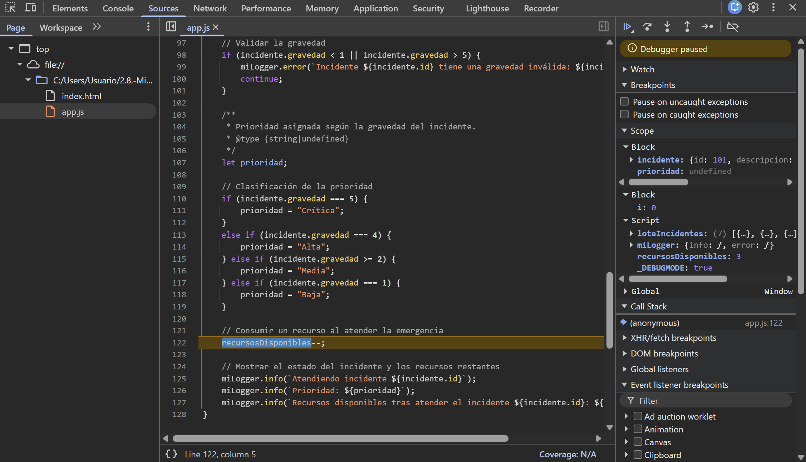
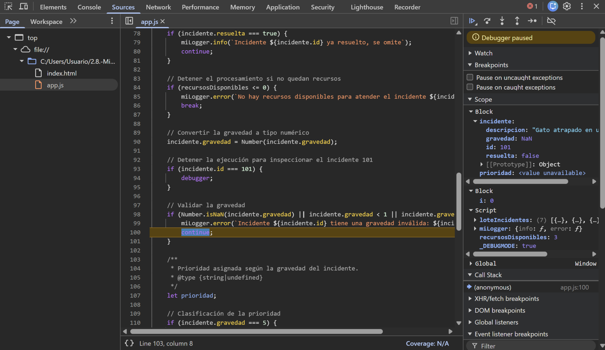
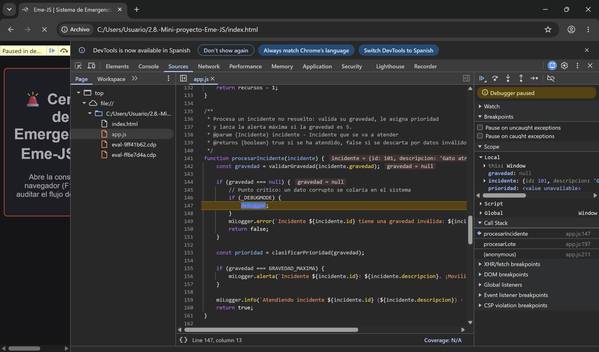
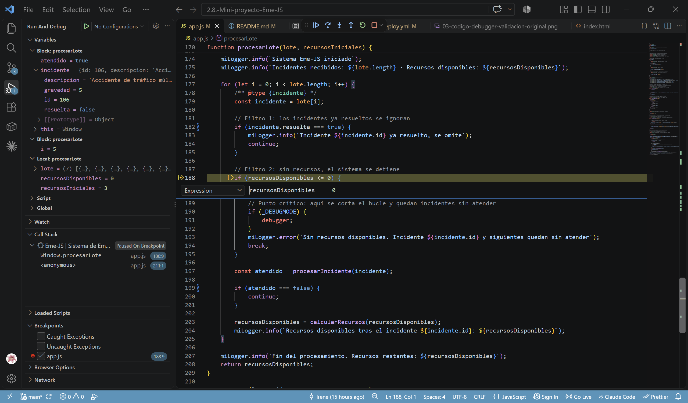
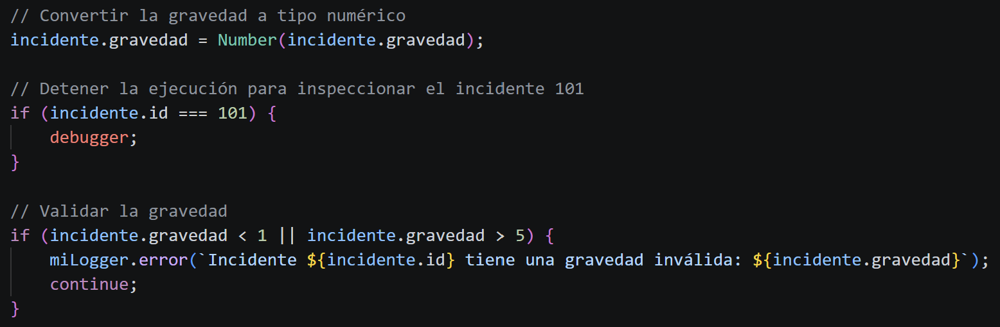
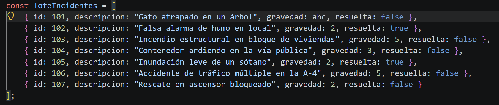
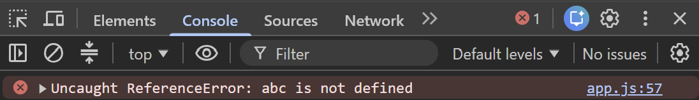
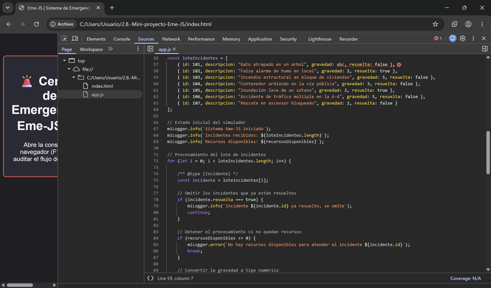
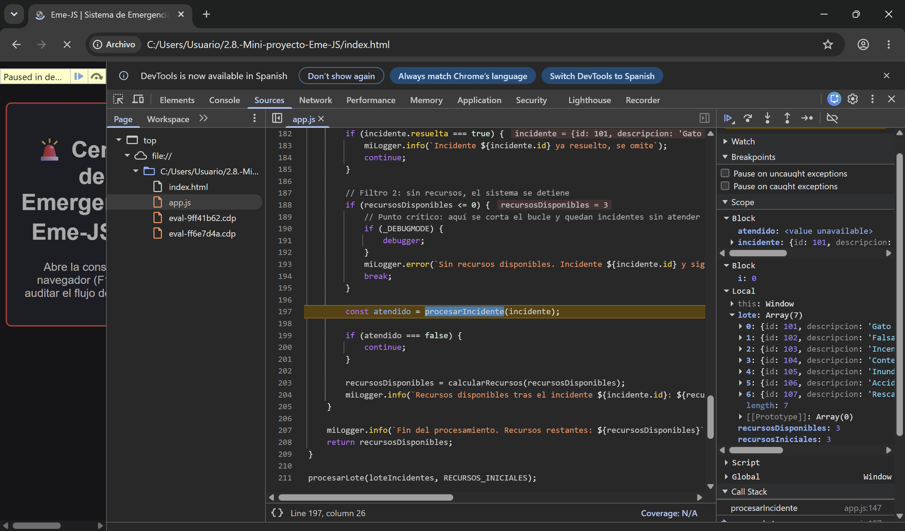
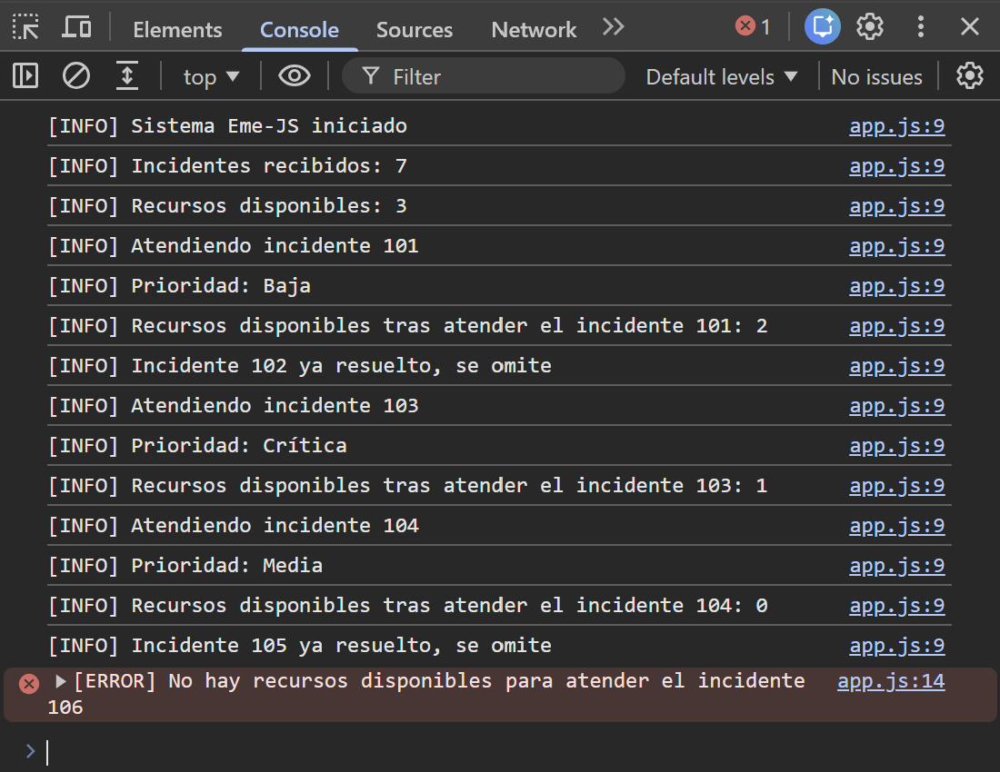

# 📔 Diario de Depuración y Co-Evaluación - Eme-JS

**Equipo:** irenepm777 (Driver inicial) & jfzdiaz3-stack (Navigator inicial)

### 🔍 Captura y Análisis de Variables (Debugger)

Para provocar un bug, cambiamos la gravedad del incidente 101 por `"abc"` y pusimos un `debugger;` en el bucle.
Avanzando con F10, el **Scope** mostró `gravedad: NaN`: la validación original (`gravedad < 1 || gravedad > 5`) no lo detectaba, porque cualquier comparación con `NaN` da `false`.
Por eso `prioridad` quedaba en `undefined` y `recursosDisponibles` bajaba de 3 a 2, gastando un recurso por un dato corrupto.
Lo corregimos con `Number.isNaN()` y comprobamos que el incidente inválido llegaba al `continue` sin consumir recursos.
Tras refactorizar en funciones, el **Call Stack** muestra la cadena `procesarIncidente` ← `procesarLote` ← `(anonymous)`, con `gravedad: null` en el Scope.
Por último, un **breakpoint condicional** (`recursosDisponibles === 0`) congela la ejecución justo antes del `break`, en el incidente 106.

| Bug detectado (Scope) | Corrección verificada | Call Stack con funciones | Breakpoint condicional |
|:---:|:---:|:---:|:---:|
|  |  |  |  |

### 👥 Experiencia de Pair Programming

Programar en pareja nos ha resultado positivo: mientras uno escribía, el otro podía centrarse en la lógica y detectar errores que se escapan al teclear.
Tener que explicar cada decisión en voz alta nos ha obligado a comunicarnos mejor y a asegurarnos de que los dos entendíamos el código.
El Navigator detectó dos errores que el Driver pasó por alto. El primero: al preparar la prueba se escribió `gravedad: abc` sin comillas, que JavaScript interpreta como una variable inexistente (`ReferenceError: abc is not defined`).
El segundo: el Driver daba por hecho que la validación cubría cualquier valor inválido, y fue el Navigator quien propuso inspeccionar el Scope, donde vimos que `NaN` se colaba.
Intercambiar los roles nos ha permitido practicar tanto escribir código como revisarlo, y el resultado final es más fiable que si lo hubiéramos hecho por separado.

*Firmado: Irene Pascual Moreno y Jose Fernandez Diaz*

---
---

# Información adicional del proyecto

## Índice

1. [Datos del proyecto y enlaces](#1-datos-del-proyecto-y-enlaces)
2. [Funcionamiento del simulador](#2-funcionamiento-del-simulador)
3. [Pair Programming e historial de commits](#3-pair-programming-e-historial-de-commits)
4. [Depuración: capturas complementarias](#4-depuración-capturas-complementarias)
5. [Automatización y despliegue CI/CD](#5-automatización-y-despliegue-cicd)
6. [Valoraciones individuales](#6-valoraciones-individuales)
7. [Tecnologías usadas](#7-tecnologías-usadas)

## 1. Datos del proyecto y enlaces

**Proyecto:** Mini-proyecto Eme-JS · Simulador de Emergencias  
**Módulo:** Desarrollo Web en Entorno Cliente (DWEC)  
**Equipo:** Irene Pascual Moreno ([irenepm777](https://github.com/irenepm777)) y Jose Fernandez Diaz ([jfzdiaz3-stack](https://github.com/jfzdiaz3-stack))

- **Repositorio:** [GitHub - Eme-JS](https://github.com/jfzdiaz3-stack/2.8.-Mini-proyecto-Eme-JS)
- **Web desplegada:** [GitHub Pages](https://jfzdiaz3-stack.github.io/2.8.-Mini-proyecto-Eme-JS/)
- **Documentación JSDoc:** [Documentación generada](https://jfzdiaz3-stack.github.io/2.8.-Mini-proyecto-Eme-JS/docs/)

## 2. Funcionamiento del simulador

Eme-JS procesa un lote de siete incidentes, los clasifica según su gravedad y gestiona los recursos de un parque de bomberos. Los mensajes se muestran en la consola del navegador (F12).

| Función | Qué hace |
|---------|----------|
| `procesarLote()` | Recorre el lote con un bucle `for`. Usa `continue` para saltar los incidentes resueltos y `break` para detener el sistema cuando no quedan recursos. |
| `procesarIncidente()` | Valida la gravedad, asigna la prioridad y lanza la alerta máxima si la gravedad es 5. Si el dato es inválido, sale con un `return` temprano (cláusula de guardia). |
| `validarGravedad()` | Solo admite números o textos, los convierte explícitamente con `Number()` y comprueba que sean enteros entre 1 y 5, para evitar errores de coerción. |
| `clasificarPrioridad()` | Asigna la prioridad con un `switch`. |
| `calcularRecursos()` | Descuenta un recurso por cada emergencia atendida. |

| Gravedad | Prioridad |
|----------|-----------|
| 1 | Baja |
| 2 - 3 | Media |
| 4 | Alta |
| 5 | Crítica (alerta máxima) |

- Todas las comparaciones son estrictas (`===`) y todos los mensajes se generan con **Template Literals**.
- Los mensajes pasan por un Logger personalizado (`miLogger`) controlado por la constante global `_DEBUGMODE`. Los mensajes `info` y el `debugger;` solo se activan con `_DEBUGMODE` a `true`. La **alerta máxima** y los **errores** se muestran siempre, porque son avisos críticos que no deben perderse en producción.
- El código está documentado con JSDoc (`@type`, `@param`, `@returns`, `@typedef` y `@property`).

## 3. Pair Programming e historial de commits

- **Driver:** escribe el código y aplica las soluciones.
- **Navigator:** revisa la lógica, detecta errores y orienta la depuración.

Hemos intercambiado los roles entre las fases de preparación, implementación, documentación/depuración y despliegue. Cada commit indica en el mensaje quién era Driver y quién Navigator.

## 4. Depuración: capturas complementarias

**Código original con el `debugger;`**, antes de corregir la validación:

**Error detectado por el Navigator:** `abc` sin comillas y el `ReferenceError` resultante:

**Cambio de nivel en el Call Stack:** parados en el `debugger;` de `procesarIncidente()` con `gravedad: "abc"`, hicimos clic en `procesarLote` dentro del Call Stack. El Scope pasa a mostrar las variables de esa función, y se ve que `recursosDisponibles` sigue en 3: el incidente inválido se descarta sin gastar recursos.

**Ejecución correcta** con los datos originales:

## 5. Automatización y despliegue CI/CD

El workflow `.github/workflows/deploy.yml` se ejecuta automáticamente con cada push o pull request fusionada en `main`, siguiendo el modelo de la presentación de teoría:

1. Descarga el código del repositorio.
2. Configura Node.js.
3. **Valida** la sintaxis de `app.js` con `node --check`. Si hay un error, el despliegue se detiene.
4. Instala JSDoc y **genera la documentación** en la carpeta `docs/`.
5. Configura GitHub Pages, empaqueta la web y la documentación, y las **despliega** en la URL pública.

Así, cada actualización de `main` se publica sin despliegue manual, y la documentación siempre está al día con el código.

## 6. Valoraciones individuales

**Irene:** El Pair Programming ha sido una experiencia bastante positiva para mí. Aunque trabajar en pareja puede resultarme un poco desafiante, esta actividad me ha empujado a salir de mi zona de confort y practicar mis habilidades de comunicación de una forma muy satisfactoria. Tener que explicar mis ideas, escuchar otras perspectivas y coordinarnos constantemente ha sido un ejercicio útil, tanto a nivel técnico como personal. Me ha gustado más de lo que esperaba, como ejercicio puntual.

**Pepe:** La experiencia de programar en pareja ha sido positiva. El intercambio de roles entre Driver y Navigator me ha servido tanto para practicar el código como para revisarlo con mi compañera. También ha sido útil para comunicarnos mejor y explicar lo que estábamos haciendo, asegurándonos de entenderlo. En general la experiencia ha hecho que el proceso del proyecto sea menos complicado y que el resultado final sea más seguro.

## 7. Tecnologías usadas

- HTML5
- JavaScript (ES6)
- JSDoc
- Chrome DevTools
- Node.js
- Git y GitHub
- GitHub Actions
- GitHub Pages